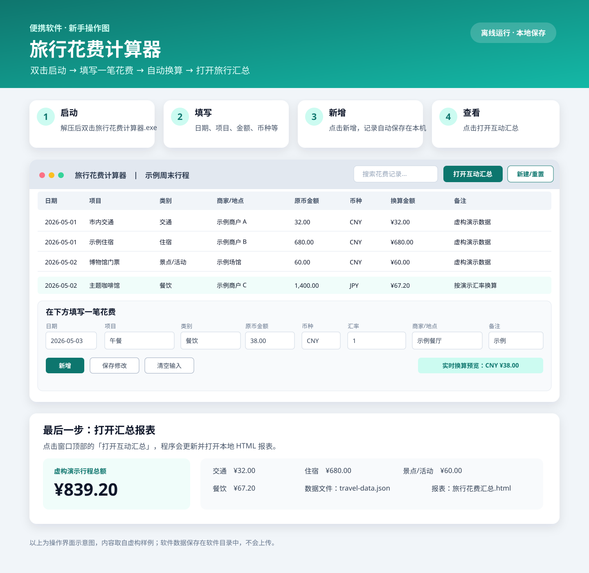

# 旅行花费计算器

Windows 便携旅行支出记录工具。解压 dist/travel-expense-calculator.zip 后，双击 旅行花费计算器.exe 即可启动。

## 便携使用

- 整个解压目录可复制到其他文件夹或移动磁盘；应用、数据和报表都使用软件目录中的相对路径。
- 启动器隐藏 PowerShell 窗口。需要 Windows PowerShell 5.1 或 PowerShell 7。
- 记录保存在 travel-data.json，汇总报表保存在 旅行花费汇总.html，无需联网即可查看。
- 首次体验使用虚构样例数据。可在程序中创建或重置行程。

## 新手操作演示

这张图按程序实际按钮整理了启动、录入、自动保存和查看报表的步骤。图中的界面和数据是示意与虚构样例。

- [打开图文演示页](demo/使用演示.html)
- [打开虚构样例报表](demo/旅行花费汇总.html)
- 样例数据：`demo/travel-data.json`

演示行程、商户和金额均为合成数据，不对应真实旅行记录。

## 源码与构建

源码和启动器构建脚本位于 source/。可在 Windows 上运行：

pwsh.exe -NoProfile -ExecutionPolicy Bypass -File ".\source\Build-Launcher.ps1"

构建需 PowerShell 与 Windows .NET Framework C# 编译器。

## 许可

MIT
